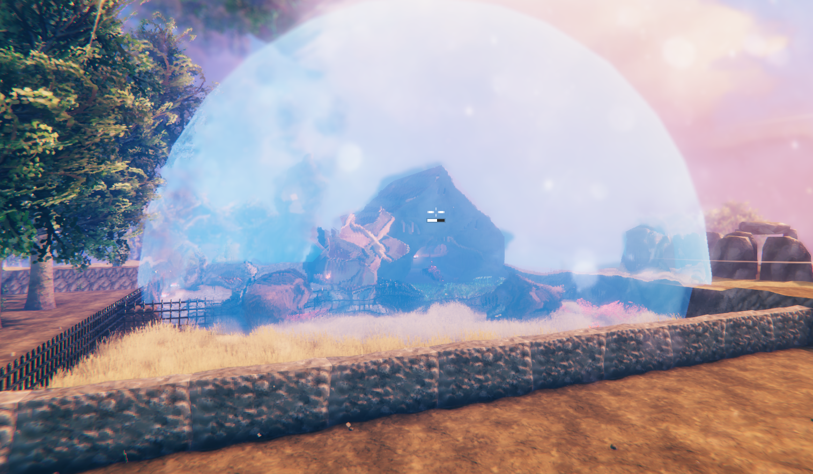
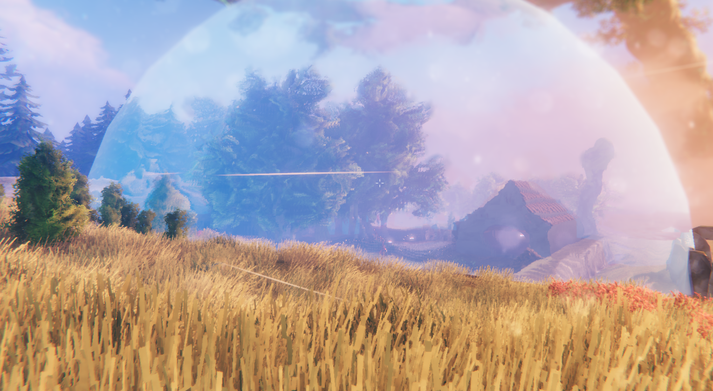

# HomeBubble

Keep enemies out of your base with a protective bubble.
The bubble even protects against projectiles and rain, and overlapping bubbles merge into one.
Keep the bubble generator fuelled with bones, and toggle it on and off with `Shift + E`.

## Building It

The bubble requires a **Workbench, Forge, Stonecutter and Artisan Table** all within build range, including range extended by [BenchLink](https://github.com/javidahmed64592/Valheim-BenchLink).
Each bubble claims one set of these stations, so two bubbles cannot be built on the same set.

Find it in the Hammer's **Defence** tab.

| Material    | Amount |
| ----------- | ------ |
| Iron        | 5      |
| Copper      | 5      |
| Dragon Tear | 2      |

## Bubble Size

The bubble grows as you build upgrades on the Workbench, Forge, Stonecutter and Artisan Table.
A Black Forge and Galdr Table within range make it grow too, but they are never required: without them the bubble simply ignores them.
The bubble always uses the most upgraded station of each type in range, so upgrading a different bench of the same type, or building a better one, makes the bubble grow.
If one of its stations is destroyed, the bubble switches to the next best one in range; if none is left, the bubble goes down until one is built.

## Configuration

Settings are in the BepInEx config file `javidahmed64592.homebubble.cfg`.
Settings marked "(Synced with server)" use the server's values when the server has the mod installed.

## Compatibility

- The bubble is built from the vanilla Shield Generator, so mods that change the Shield Generator may change the bubble too.
- Mods that change how monsters avoid safe zones, such as the trader's camp, may change how the bubble keeps them out.
- This mod has not been tested with a gamepad, only with keyboard and mouse.

## Uninstalling

Home Bubbles disappear from the world when the mod is removed, along with any bones in them.
Deconstruct them first to get their materials back.

## License

This project is licensed under the MIT License - see the [LICENSE](https://github.com/javidahmed64592/Valheim-HomeBubble/blob/main/LICENSE) file for details.
